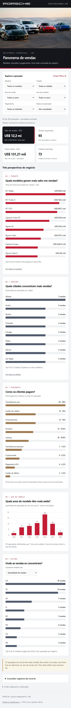

# Porsche — Panorama de vendas

Dashboard educacional para o desafio DIO. HTML único com CSS, JavaScript e dados incorporados, sem CDN ou dependências para uso. Abra `index.html` no navegador, inclusive offline.

**[Abrir dashboard publicada](https://carolina-ventrella.github.io/porsche-sales-dashboard/)** · [Repositório público](https://github.com/carolina-ventrella/porsche-sales-dashboard)

## Perguntas de negócio

1. Quais modelos geram mais valor em vendas? Ranking pelo preço acumulado, com top 8 e expansão para todos.
2. Quais cidades concentram mais vendas? Ranking pela quantidade de operações, com tratamento explícito dos empates.
3. Como os clientes pagam? Quantidade e participação de cada método no recorte.

As perguntas conectam produto, presença geográfica e condições de pagamento. O valor por modelo ajuda a entender a composição comercial; a quantidade por cidade mostra onde as operações se concentram; a participação por pagamento permite comparar o uso dos métodos. São descrições da amostra, não recomendações de estoque nem conclusões sobre o mercado real. Barras horizontais permitem comparar categorias e ler nomes longos; todos os rankings começam em zero.

Filtros: modelo, cidade, ano da venda, ano do modelo, pagamento e status. Barras também filtram os dados. Indicadores: valor de vendas, operações, ticket médio e cidades. Tabela e CSV acompanham todos os filtros.

## Fonte e metodologia

[Planilha base Porsche](https://hermes.dio.me/files/assets/8683bed0-cc33-4e06-bca9-04db9c31f9e2.xlsx), aba `Sanitized`. Base educacional estática com 100 registros e identificadores únicos. Uso dos campos sanitizados e ID, sem nomes de clientes ou vendedores. Nenhuma fórmula na origem. Anos convertidos para inteiros e preços para centavos inteiros de USD, preservando precisão nas somas. A base sanitizada está em `base-sanitizada.csv`, sem fórmulas.

- 24 datas inválidas: mantidas como ausentes, sem estimar datas. Entram nos totais e na opção “Sem data válida”; ficam fora de anos específicos.
- 7 cancelamentos: excluídos por padrão, acessíveis no filtro de status.
- Total bruto, com cancelamentos: **US$ 12.827.800,50 / 100 operações**.
- Total inicial, sem cancelamentos: **US$ 12.202.550,50 / 93 operações**.
- A base contém datas até 2027. Não são dados oficiais nem acompanhamento em tempo real.
- Valor de vendas é preço somado, incluindo pendências, e não receita contábil reconhecida. Ticket médio = soma / operações.
- Wire Transfer e Bank Transfer permanecem categorias distintas conforme a origem.

Visual: grafite `#14161b`, vermelho `#c51d35`, fundo claro `#f3f4f6`; fonte de sistema Segoe UI/Arial, sem downloads. Layout adaptável e controles acessíveis por teclado.

A referência visual é o [site oficial da Porsche Brasil](https://www.porsche.com/brazil/pt/): contraste entre superfícies escuras e claras, tipografia sem serifa, títulos de destaque e espaço entre elementos. A composição foi adaptada à leitura analítica, com vermelho para destaque e cores distintas nos gráficos. A revisão local inclui a foto fornecida pela usuária e o [logotipo tipográfico Porsche](https://commons.wikimedia.org/wiki/File:Porsche_Wordmark_Logo_Black.svg), de autoria da Porsche AG, incorporados ao HTML. Não há vínculo com a Porsche. A foto foi otimizada em WebP; as fontes continuam Segoe UI/Arial.

## Revisão com foto e novos gráficos

Comparação com a [dashboard da DIO](https://digitalinnovationone.github.io/dashboard_porsche_sales/), feita pela leitura de seu HTML e configurações de gráficos:

| Aspecto | Referência DIO | Esta dashboard revisada |
| --- | --- | --- |
| Modelos | Barras por quantidade | Barras por valor de vendas, filtráveis por cidade |
| Ano do modelo | Rosca | Colunas cronológicas, com eixo iniciado em zero |
| Estados | Barras com dois eixos: vendas e receita | Ranking top 8 com seletor de quantidade ou valor, evitando confundir unidades |
| Análises adicionais | Leitura executiva | Rankings por cidade e pagamento, CSV e tratamento explícito de datas inválidas |
| Execução | Gráficos com Chart.js | HTML independente, gráficos em CSS/SVG e imagens incorporadas |

Foram preservadas as cores e a fonte da dashboard principal. Os dois gráficos adicionais respondem quais anos de modelo têm mais saída e quais estados concentram quantidade ou valor de vendas. Todos os filtros existentes também afetam essas análises. A versão final está preparada para publicação na conta carolina-ventrella, com GitHub Pages na branch main.

## Caminho utilizado e evolução do prompt

Esta entrega foi concluída com **agente Codex e skills de planilhas e dashboards**, reaproveitando e validando a implementação existente no workspace. Não foi executada uma sessão do ChatGPT Canvas; portanto, não se apresenta uma comparação experimental entre os dois caminhos. O prompt abaixo permite reproduzir o trabalho no Canvas ou em outro agente.

O briefing de entrada pediu um HTML único, três perguntas escolhidas pelo agente, filtros, indicadores, referência visual Porsche e publicação no GitHub Pages. O prompt consolidado abaixo incorpora as decisões da base: moeda USD, datas inválidas, cancelamentos, diferença entre ano da venda e do veículo e a distinção entre valor de vendas e receita reconhecida. Ele é uma especificação reprodutível, não uma transcrição de uma sessão de Canvas.

Na revisão final, foram conferidos os dados contra um novo download da fonte (mesmo SHA-256), acrescentados o total exato abaixo do indicador compacto e o link para código/metodologia, e completada a documentação com evidências. Os 100 registros foram preservados; o padrão de 93 é um filtro, não exclusão de linhas da base.

## Evidência de funcionamento

Selecione **Modelo → 911 Dakar**, mantendo **Status → Sem canceladas**. O resultado é **3 operações**, **US$ 810.600,00**, ticket médio de **US$ 270.200,00** e **3 cidades**. Gráficos, tabela e CSV usam o mesmo recorte. Uma dessas operações não tem data válida.

Validações executadas: `node test.mjs` confere os totais, reconciliação dos agrupamentos, datas inválidas, filtro por ano, filtros combinados, estado vazio, restauração, CSV e HTML independente. No navegador, foram conferidos visão geral, filtro 911 Dakar e combinação sem resultados (911 Dakar + Boston), sem erros ou avisos no console durante essa verificação. As capturas mostram a página em execução, não mockups.

## Publicação

GitHub Pages configurado para a branch `main`, pasta `/`, com HTTPS. O arquivo de entrada é `index.html`. Não há backend, login, banco de dados ou dependência de Excel no navegador. Os dados ficam incorporados ao HTML; atualizar a planilha exige regenerar o arquivo e publicar um novo commit.

## Reproduzir

1. Baixe a fonte como `base-porsche.xlsx` nesta pasta.
2. Com Python e openpyxl disponíveis, execute `python prepare.py` para validar os tipos, exportar os dados e gerar `index.html` a partir do template.
3. Execute `node test.mjs` para conferir totais, reconciliação, filtros, datas inválidas, estado vazio, restauração e exportação CSV.
4. Publique a raiz do repositório no GitHub Pages, branch `main`.

O arquivo `index.html` é o produto final independente; os demais arquivos permitem reproduzir e auditar o trabalho.

## Prompt para reproduzir no Canvas

Crie um dashboard em um único index.html, sem dependências externas, usando os dados sanitizados anexados. Use somente campos sanitizados e o ID; converta preço USD para centavos inteiros e ano do modelo para número. Não invente datas: mantenha as inválidas sem data. Exclua canceladas por padrão, permitindo incluí-las pelo filtro de status. Responda com gráficos: quais modelos geram mais valor de vendas, quais cidades concentram mais operações e qual a participação dos métodos de pagamento. Inclua filtros combináveis por modelo, cidade, ano da venda, ano do modelo, pagamento e status; indicadores de valor de vendas, operações, ticket médio e cidades; tabela e exportação CSV do mesmo recorte; estado vazio e limpeza dos filtros. Use grafite, branco e vermelho com Segoe UI/Arial, layout responsivo e acessibilidade. Explique que valor de vendas não equivale a receita contábil e que a base é educacional, estática e inclui datas até 2027. Preserve categorias de pagamento da fonte. Não publique nomes de clientes e vendedores.

